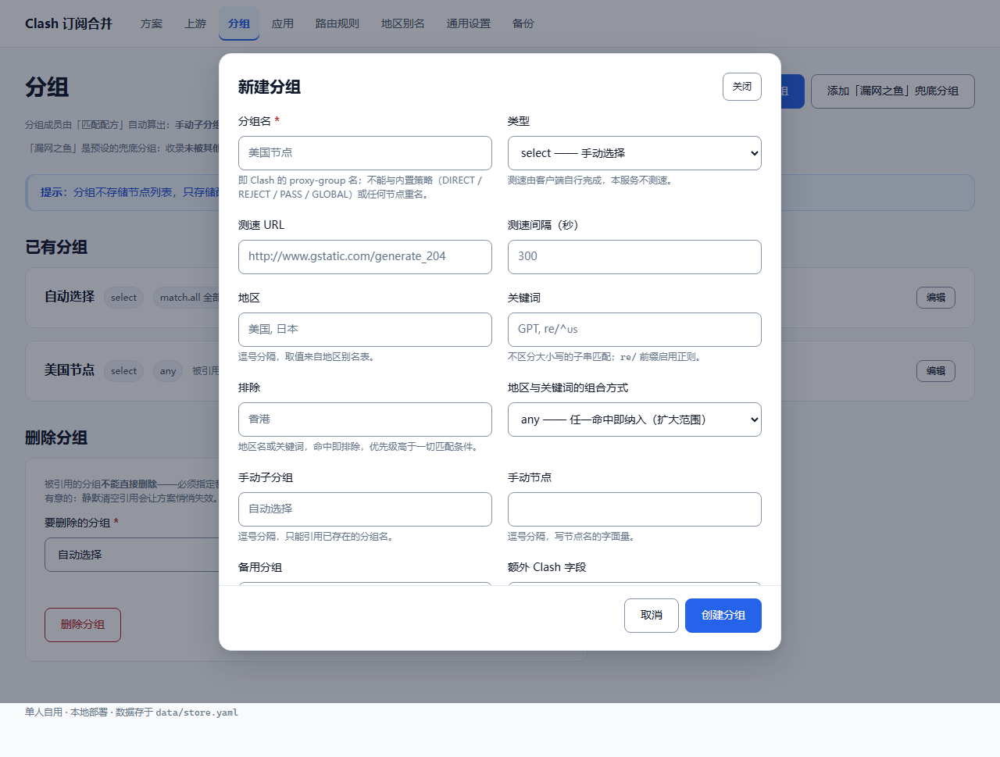
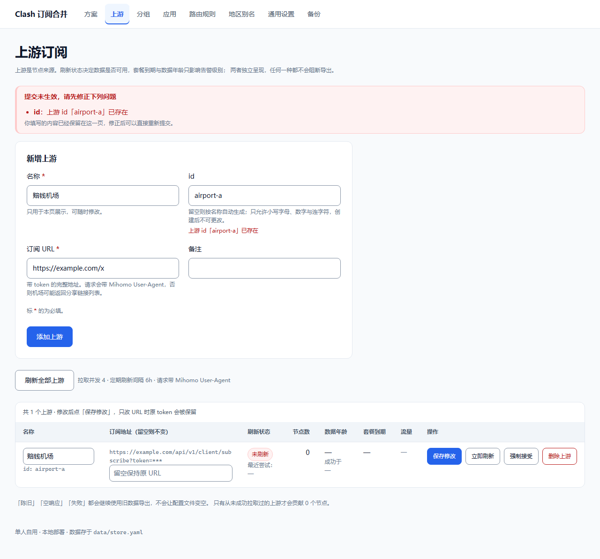

# Web 应用 UI 设计规范

版本：2.0 · 固定两套主题：晨雾浅色 / 午夜深色 · 配套文件：[`static/frost.css`](../static/frost.css)（主题与组件）、[`static/ui-tokens.css`](../static/ui-tokens.css)（桥接与项目扩展）、[`static/frost.js`](../static/frost.js)（主题与交互）

本规范用于统一 Web 应用的视觉和交互，适合工具类产品、业务系统、SaaS 与管理后台。内容型、电商或品牌网站可以调整页面结构，但应继续遵循统一的设计变量、组件和状态规则。

这里给出的是一套可以直接启动项目的默认值，并非所有产品都必须使用蓝色或同一种布局。已有品牌规范时，应集中替换设计变量，并重新检查对比度和组件状态。

> **本仓库落地位置**
>
> - 主题与组件的唯一来源：`static/frost.css`（与 `demo/frost.css` 逐字节一致）。`templates/base.html` 在样式前加载 `static/frost.js`，再依次加载 `frost.css`、`style.css`。
> - 变量桥接：`static/ui-tokens.css` 把 `--ui-*` 映射到 frost 的 `--bg` / `--surface` / `--text` / `--accent` / `--glass-bg` 等，并保留项目专属的间距、字号、状态色；`static/style.css` 顶部 `@import "ui-tokens.css";`，全部规则只引用语义化变量。
> - 交互增强：`static/frost.js` 负责主题切换与持久化；`static/app.js` 负责确认弹窗、表单弹窗、提交中的按钮状态、错误页返回。这些都不改变服务端行为：无 JS 时表单照常提交，新增类表单由服务端渲染成带 `open` 的页内表单。
> - 页面骨架：`templates/base.html` 提供跳过链接、地标、导航选中态与移动端抽屉导航；`templates/error.html` 是统一错误页。
> - 落地情况与已知偏差见文末「13. 落地情况与偏差」。
> - 本规范与 `AGENTS.md` 冲突时，以 `AGENTS.md` 的架构硬约束（尤其 §2「前后端不分离」）为准：本规范约束视觉与交互，不引入前端框架或构建工具链。

## 1. 执行原则

- **必须**：项目内统一执行；例外需明确原因并记录。
- **建议**：默认采用，可根据实际内容、设备和业务调整。
- **可选**：有明确需求时启用，不应为了装饰增加复杂度。

统一 UI 的核心是：**相同含义使用相同视觉，相同操作使用相同交互，相同场景复用相同组件。**

1. **内容优先**：先明确用户任务和信息层级，再设计装饰。
2. **克制强调**：使用留白、字号和字重表达层级；品牌色主要标识关键操作和选中状态。
3. **一致反馈**：用户操作后应能判断是否已响应、是否完成、失败后如何处理。
4. **组件复用**：新增页面优先使用现有组件与模板，禁止随意复制后微调出另一套风格。
5. **可访问性内置**：键盘操作、焦点、对比度和错误提示属于基础要求。

## 2. 颜色

### 2.1 默认色板

业务代码必须使用语义化变量，例如 `var(--ui-text-primary)`，避免散落的十六进制颜色。

主题色由 `static/frost.css` 的语义变量定义（AGENTS.md §6 规定的两套固定主题），`ui-tokens.css` 只做 `--ui-*` → frost `--*` 的桥接，业务 CSS 继续引用 `--ui-*`。

| 用途 | 晨雾浅色 `light` | 午夜深色 `dark` | 使用规则 |
| --- | --- | --- | --- |
| 页面背景 | `#F3F6FB`（`--bg`） | `#0B1120` | 页面最底层背景 |
| 兼容回退底色 | `#FFFFFF`（`--surface`） | `#0F172A` | 仅用于无滤镜兜底与原生选择菜单选项 |
| 主要文字 | `#172033`（`--text`） | `#F1F5F9` | 标题和主要内容 |
| 次要文字 | `#4B5870`（`--text-muted`） | `#B8C4D8` | 描述、标签和辅助信息 |
| 强调色 | `#1D4ED8`（`--accent`） | `#93C5FD` | 主按钮、链接、选中强调、焦点环 |
| 强调色文字 | `#FFFFFF`（`--accent-text`） | `#0B1120` | 强调色之上的文字 |
| 玻璃背景 | `rgb(255 255 255 / 52%)`（`--glass-bg`） | `rgb(15 23 42 / 48%)` | 顶栏、卡片、表格容器、浮层 |

业务侧引用 `--ui-brand`、`--ui-bg-page`、`--ui-bg-surface`、`--ui-text-primary`、`--ui-text-secondary`、`--ui-border-subtle`、`--ui-border-control`、`--ui-button-bg`、`--ui-control-bg`、`--ui-glass-bg`、`--ui-text-*` / `--ui-bg-*` 状态族；主题色变量本身只在 `frost.css` 定义，避免出现第二套主题来源。

### 2.2 使用规则

- 必须区分品牌色与状态色。红色不能仅用来吸引注意，绿色不能同时表示“成功”和“未处理”。
- 状态必须同时提供文字或图标，不能只靠颜色区分。
- 正文中的链接默认显示下划线，或提供等效的非颜色识别方式。
- 禁止为每个模块随机选择不同颜色；数据可视化应使用独立、固定的系列色板。
- 禁用状态使用专用文字和背景变量，不建议直接降低整个组件的透明度。
- 毛玻璃是唯一材质且恒为开启（AGENTS.md §7）：不提供实色模式、材质开关或关闭玻璃的属性；渐变、大面积高饱和背景仍属受控装饰，不作为默认风格。

### 2.3 对比度基线

以 WCAG 2.2 AA 为目标：普通文字对比度至少 **4.5:1**；大号文字至少 **3:1**；识别控件和状态所必需的非文字视觉信息至少 **3:1**。大号文字指至少 24 CSS px 的常规文字，或约 18.7 CSS px 的粗体文字。禁用控件有标准豁免，但仍建议保持可辨认。

对比度必须在**实际合成后的背景**上测量（见 AGENTS.md §5、§7、§10），不能只比较变量里的基础色。本项目已用真实浏览器在 52% / 48% 的玻璃背景上复测：正文与输入文字约 15.7–16.8:1，控件边框约 6.1–10.3:1，焦点环约 6.5–12.9:1，两套主题均满足 AA。玻璃容器内 `.glass` 会把 `--ui-text-secondary` 映射到 `--text`，避免半透明背景削弱次要文字对比度。

## 3. 字体与文字

### 3.1 字体系统

- 中文和普通界面文字使用系统无衬线字体栈，避免一个页面混用多套字体。
- 代码、标识符和需要等宽对齐的内容使用等宽字体；业务数字优先启用 `font-variant-numeric: tabular-nums`。
- 默认正文 14px，长篇阅读内容和移动端表单输入建议 16px；12px 仅用于少量非关键信息。
- 字重限制为 400、500、600、700 四档，优先使用 400 和 600。

| 层级 | 字号 | 字重 | 行高 | 场景 |
| --- | --- | --- | --- | --- |
| 页面标题 | 28px | 600 | 1.3 | 页面唯一主标题 |
| 大分区标题 | 24px | 600 | 1.3 | 少量重要内容分区 |
| 区块标题 | 20px | 600 | 1.4 | 主要模块标题 |
| 卡片标题 | 16px | 600 | 1.5 | 卡片、表单分组标题 |
| 正文 / 控件 | 14px | 400 / 500 | 1.5 | 表单、表格、按钮、一般内容 |
| 阅读正文 | 16px | 400 | 1.7 | 文档、说明和长内容 |
| 辅助信息 | 12px | 400 | 1.5 | 时间、次要统计和补充说明 |

### 3.2 文案规则

- 按钮使用明确的动作词，例如“保存修改”“创建项目”“删除成员”，避免含糊的“确定”“操作”。
- 同一概念只使用一种名称，例如不要交替使用“成员”“用户”“账号”指代同一对象。
- 统一日期、时间、数值、单位和时区展示规则，并按产品目标地区进行本地化。
- 错误文案说明发生了什么、用户可以怎么处理；避免只显示错误码。
- 长文本截断必须提供查看完整内容的方式；提示浮层不能成为触屏或键盘用户唯一的入口。
- 不使用空格字符手动排版；通过布局、对齐和间距完成排版。

## 4. 间距、尺寸、圆角与阴影

### 4.1 间距

以 **4px** 为基础单位，使用固定尺度：`0、4、8、12、16、20、24、32、40、48、64px`。边框、图标绘制和光学校正可以不受此约束。

| 场景 | 默认值 |
| --- | --- |
| 图标与文字 | 8px |
| 同组按钮之间 | 8px |
| 标签与表单控件 | 8px |
| 控件与帮助 / 错误文字 | 4px |
| 表单字段之间 | 20px |
| 卡片内边距 | 24px；窄屏 16px |
| 区块之间 | 24–32px |
| 页面左右留白 | 桌面 32px；平板 24px；手机 16px |

相关内容靠近，不同分组拉开。禁止仅靠堆叠多个空容器制造间距。

### 4.2 控件尺寸与密度

- 默认按钮、输入框和选择器使用 **44px 最小高度**；同一行保持相同尺寸。
- 高密度桌面工具区可统一使用 **36px 紧凑规格**，但需要单独评估触屏和键盘体验。
- 常规触控目标建议至少 **44 × 44px**；可交互图标的点击区域应包含内边距。
- WCAG 2.2 AA 的目标尺寸基线是 24 × 24 CSS px，并存在间距等例外；项目默认按更易操作的 44px 设计。
- 高度优先用 `min-height` 配合内边距，允许放大文字、多语言和内容换行。
- 密度作为页面或容器级设置统一切换，禁止同类控件无理由混用高度。

### 4.3 圆角与阴影

| 对象 | 默认值 |
| --- | --- |
| 按钮、输入框、普通菜单项 | 10px 圆角 |
| 卡片、下拉面板、内容面板 | 16px 圆角 |
| 弹窗、主要浮层 | 16px 圆角 |
| 头像、状态圆点、胶囊标签 | 按语义使用圆形或全圆角 |
| 普通内容卡片 | 边框为主，默认无阴影 |
| 悬浮菜单 / 弹窗 | 使用对应层级阴影 |

禁止每个区块都同时使用明显边框和重阴影。阴影表达浮起关系，不用于强调所有重要内容。

## 5. 页面布局与响应式

### 5.1 页面骨架

业务页面建议采用统一结构：**全局导航 → 页面标题与主操作 → 筛选 / 工具区 → 主内容 → 分页或底部操作**。面包屑仅在具有层级关系时出现。

- 同类页面必须复用相同骨架，标题、筛选和主要操作的位置保持一致。
- 导航选中态同时使用颜色与背景、字重或标识线，不能只改变图标颜色。
- 普通内容区建议最大宽度 1440px；宽数据表可按业务需求扩展。
- 表单内容建议最大宽度 720px；阅读正文建议控制在约 65ch，并检查中文实际阅读宽度。
- 页面标题与工具栏在窄屏允许换行，不能挤压正文或强制缩小字号。
- 不要将每一段内容都包装成卡片；只有独立任务、实体或信息分组才需要独立容器。

### 5.2 默认断点

断点以 CSS px 为单位，按内容是否能正常排布决定最终行为，不以具体设备型号判断。

| 宽度 | 默认行为 |
| --- | --- |
| `< 768px` | 单列内容；导航使用抽屉；筛选允许折叠；表单单列 |
| `768–1023px` | 根据内容使用一到两列；侧栏可收起；工具区允许换行 |
| `≥ 1024px` | 使用完整桌面布局；侧栏默认 240px；复杂内容可使用多列 |
| `≥ 1440px` | 根据内容上限控制宽度，避免文字和表单无限拉伸 |

- 普通页面应在 **320 CSS px 宽度**下正常重排，避免整页横向滚动。
- 数据表、地图等确实需要二维布局的内容可以在独立区域内滚动，不能让操作入口消失。
- 手机端保留核心任务、状态和操作；隐藏非关键字段时应提供详情入口。
- 固定头部、底部按钮和软键盘不能遮挡当前焦点、错误提示或主要操作。
- 不依赖悬停才能发现关键功能，触屏应有可见入口。

## 6. 组件规则

每个组件必须定义适用场景、尺寸、状态和键盘行为。优先复用成熟组件库并统一主题；项目只保留一套基础组件体系。

| 组件 | 统一规则 |
| --- | --- |
| 按钮 | 每个操作组通常只有一个主按钮；次要操作使用描边或文字按钮；危险操作使用危险样式。图标按钮必须有可访问名称。 |
| 输入框 | 标签默认放在控件上方并持续可见；占位符不能代替标签；填写格式或限制在输入前说明。 |
| 表单 | 必填规则明确；错误显示在对应字段附近并建立程序关联；提交失败保留已填内容；长表单可增加错误摘要。 |
| 选择器 | 少量互斥选项可用单选组，多个独立选项用复选框，较多选项再使用下拉；选项多时提供搜索。 |
| 开关 | 表示立即生效的二元设置；如果需要统一提交，优先使用复选框，或明确说明保存方式。 |
| 标签 / 徽标 | 用于分类、状态或数量；同一状态在全站保持同一文案和色彩；不能让静态标签看起来像按钮。 |
| 卡片 | 标题、内容、操作顺序一致；可点击卡片要有明确提示，并避免整个卡片链接与内部按钮互相冲突。 |
| 表格 | 文字左对齐，数值按列右对齐并统一小数位；表头标注单位；排序、筛选、选中状态可见；行操作位置统一。 |
| 列表 / 分页 | 批量操作、当前页和总量语义清楚；跨页选择必须明确范围；筛选改变后同步调整分页。 |
| 页签 | 用于切换同一区域的内容；选中状态明确；页签过多时采用滚动、溢出菜单或重新分组。 |
| 弹窗 | 用于需要聚焦处理的短任务；有明确标题、关闭入口和结果操作；避免嵌套弹窗。 |
| 抽屉 | 用于与当前列表相关的详情或编辑；保留上下文；窄屏可转为全屏。 |
| 提示消息 | 简短结果可用 Toast；字段问题用字段错误；持续问题用页面提示条；关键结果不能只靠自动消失的消息。 |
| 提示浮层 | 只补充信息，不能承载唯一的关键说明或必需操作；应支持键盘触发。 |
| 图标 | 全站使用同一套图标；常规尺寸为 16、20、24px；统一线宽和视觉重量；装饰图标对辅助技术隐藏。 |

表格补充要求：长文本可截断但能查看完整内容；横向滚动时可固定关键标识列和必要操作列，但必须测试窄屏空间与遮挡。没有稳定行标识的列表不得仅靠颜色显示选中项。

## 7. 状态与反馈

### 7.1 组件状态

可交互组件需要覆盖其适用的状态：默认、悬停、按下、键盘焦点、选中 / 展开、禁用、加载、校验失败。组件不适用的状态不需要强行实现。

- 键盘焦点必须清晰可见，不能直接删除浏览器默认焦点而不提供替代。
- 默认焦点样式为 2px 外描边与 2px 间距；在不同背景上检查可见性，必要时使用双色焦点环。
- 禁用状态不能作为唯一解释方式；必要时在附近说明前置条件。
- 加载中的提交按钮保留文字与宽度，并防止重复提交；仅阻止会冲突的操作。
- 校验错误不能只用红色边框表达，必须提供文字说明。

### 7.2 页面状态

| 状态 | 必须提供的内容 |
| --- | --- |
| 首次加载 | 与内容形态匹配的占位；结构稳定时可用骨架屏，避免明显布局跳动 |
| 局部刷新 | 保留可用的已有内容，并标明刷新中；不必反复清空整个页面 |
| 初始空状态 | 说明当前没有什么，并给出创建或导入等适用入口 |
| 无搜索结果 | 展示当前搜索 / 筛选语境，并提供清除或修改条件的方式 |
| 请求失败 | 明确失败范围、保留可恢复内容，并提供重试或替代路径 |
| 无权限 | 说明权限不足，并在产品支持时提供申请或联系入口 |
| 操作成功 | 让用户看到结果变化；需要时补充成功提示，避免重复弹出多条消息 |

空数据、无权限和加载失败不能复用同一个“暂无数据”页面。状态区域应预留合理空间，避免加载完成后页面剧烈跳动。

## 8. 交互与动效

- 相同操作的反馈、位置和快捷键保持一致；返回和取消应符合用户对上下文的预期。
- 可撤销的低风险操作优先提供撤销；不可逆、高影响操作使用确认流程，并说明对象和后果。
- 不为每次普通保存增加确认框。编辑内容尚未保存时，按风险提供离开提醒或可靠的自动保存。
- 表单校验通常在离开字段和提交时触发；用户开始修正错误后应及时更新反馈，避免刚输入就不断报错。
- 成功、失败和加载信息应通过适当的可访问状态通知传达，不能只依赖视觉动画。
- 按钮反馈建议 120–160ms，菜单和浮层建议 160–240ms；全站使用统一缓动曲线。
- 优先动画化 `opacity` 与 `transform`，避免通过动画频繁改变布局尺寸。
- 响应 `prefers-reduced-motion: reduce`：取消非必要位移和缩放动效，保留静态进度与状态信息。
- 动画必须服务于反馈或空间关系，不阻塞任务，不自动循环吸引注意。

## 9. 可访问性与主题

- 使用语义化元素：导航用链接，动作使用按钮；不把普通 `div` 直接当按钮使用。
- 所有操作必须可通过键盘完成，焦点顺序与阅读顺序一致，避免正数 `tabindex`。
- 模态弹窗打开后将焦点移入，限制焦点在弹窗内，关闭后恢复到合理位置；提供键盘退出方式。
- 输入框具有可访问标签；帮助文字和错误信息与控件关联；页面标题层级连续、含义清楚。
- 200% 文字放大时不得丢失内容或功能；测试窄屏重排、系统字体放大和长文案。
- 图片有合适的替代文本；纯装饰图片使用空替代文本；图表提供数值、文字说明或可访问的数据入口。
- 仅允许「晨雾浅色」与「午夜深色」两套主题，通过根元素 `data-theme="light|dark"` 表达并同步 `color-scheme`；不直接反转浅色值。
- 必须提供「浅色 / 深色 / 跟随系统」三态：首次访问跟随系统，手动选择后保存，恢复跟随系统时清除覆盖并在系统主题变化时同步更新。
- 只保存主题选择，使用 `web-standards.preferences.v3` 格式；兼容读取 v1/v2 时仅继承有效主题值，忽略旧材质字段。存储不可用时页面仍可切换主题。

## 10. 工程落地与规范维护

1. **建立唯一来源**：颜色、字号、间距、圆角、阴影、尺寸、动效与层级统一进入设计变量。
2. **变量表达语义**：业务组件引用 `--ui-text-secondary`，不要引用“灰色 500”或任意颜色值表达业务含义。
3. **优先使用语义 HTML 和基础组件**：建立 Button、Input、Select、Dialog、Table、EmptyState 等公共组件，业务页面通过公开属性配置。
4. **统一变体**：用 `variant`、`size`、`density`、`state` 等属性控制差异，避免在页面中随意覆盖组件内部样式。
5. **建立页面模板**：至少沉淀列表页、详情页、表单页；仪表盘根据业务需要增加。
6. **集中定义层级**：普通内容 0、吸顶区域 100、普通下拉 200、模态遮罩 300、模态内容 310、提示消息 400、提示浮层 500；这些是层级约定，必须同时管理 stacking context 与 Portal 挂载位置。弹窗内菜单须挂到对应弹窗层或使用支持 top layer 的方案。
7. **维护组件示例**：在组件文档或 Storybook 中展示不同尺寸、主题和关键状态，包括长文本及窄屏效果。
8. **限制局部例外**：新样式先检查能否通过已有变量或组件变体实现；确需新增时记录使用场景并更新文档。
9. **检查关键流程**：对创建、编辑、提交、删除等关键路径进行人工验收；自动化视觉回归优先覆盖稳定的核心页面和状态。
10. **设定维护责任**：指定规范维护者；调整公共变量或组件时说明影响范围，避免同一版本出现新旧样式混用。

### 配套变量使用方式

在应用入口引入 `ui-tokens.css`，再将变量映射到组件库主题或自建组件。该文件只定义变量，不自动改写现有页面样式。

本仓库的样式入口是 `static/style.css`，与变量文件同目录：

```css
@import "ui-tokens.css";

.page {
  color: var(--ui-text-primary);
  background: var(--ui-bg-page);
  padding: var(--ui-space-8);
  font-family: var(--ui-font-sans);
  font-size: var(--ui-font-size-base);
  line-height: var(--ui-line-height-body);
}

.panel {
  padding: var(--ui-space-6);
  border: 1px solid var(--ui-border-subtle);
  border-radius: var(--ui-radius-panel);
  background: var(--ui-bg-surface);
}

@media (max-width: 767px) {
  .page { padding: var(--ui-space-4); }
  .panel { padding: var(--ui-space-4); }
}
```

CSS 自定义属性不能直接作为原生 `@media` 条件中的断点。断点应在样式预处理、构建配置或项目统一约定中维护。

## 11. 页面交付验收清单

- [ ] 同类页面使用统一骨架，标题、导航和主操作位置一致。
- [ ] 颜色、字体、间距、尺寸、圆角和阴影来自设计变量。
- [ ] 每组操作的优先级清晰，危险操作与普通操作能够区分。
- [ ] 同一语义使用相同文案、颜色、图标和反馈方式。
- [ ] 表单具有持续可见的标签、明确的必填规则和可恢复的错误反馈。
- [ ] 已覆盖适用的加载、空数据、无结果、失败、无权限和成功状态。
- [ ] 鼠标、键盘、触屏均能完成关键任务，焦点可见且不被遮挡。
- [ ] 文字、控件边界和状态标识的对比度达标，信息不只依赖颜色。
- [ ] 已检查 320、768、1024、1440px 及布局转折宽度，普通内容没有意外横向溢出。
- [ ] 长标题、长姓名、大数字、多语言、文字放大不会造成内容丢失或操作不可达。
- [ ] 表格和复杂二维内容可独立滚动，并能访问关键字段和操作。
- [ ] 动效遵循统一时长，并正确响应减少动态效果的系统偏好。
- [ ] 若支持多主题，每个主题均经过独立验收。
- [ ] 新组件、变体与例外已经进入公共文档。

## 12. 可直接放入项目说明的简版约束

> 本项目采用简洁、中性的 Web UI 风格。所有页面必须优先复用现有组件和页面模板，使用统一的语义化设计变量。品牌主色默认为 #2563EB，页面底色为 #F8FAFC，内容表面为白色；状态色只表达相应语义。布局使用 4px 间距尺度，默认控件最小高度 44px，控件 / 卡片 / 弹窗圆角分别为 10 / 16 / 16px。标题、正文、辅助信息遵循固定字体层级，每组操作保持清晰主次。实现适用的交互状态和页面异常状态，支持键盘操作、可见焦点、响应式重排及减少动态效果。禁止任意新增色值、混用图标体系、局部覆盖出另一套组件风格，或只完成正常状态。新增规范必须记录并同步到公共组件与文档。

## 13. 落地情况与偏差

### 13.1 已落地的项

| 规范条目 | 落地方式 |
| --- | --- |
| §2 颜色 | 主题色来自 `frost.css`，经 `ui-tokens.css` 桥接为 `--ui-*`；`style.css` 内无字面色值；状态一律「颜色 + 文字」 |
| §1 单一主题来源 | `--ui-*` 全部别名到 frost 的语义变量，无第二套主题定义；`frost.css`/`frost.js` 与 `demo/` 逐字节一致 |
| §3 字体 | 正文 14px、辅助 12px、阅读 16px；字重只用 400 / 500 / 600；数字列启用 `tabular-nums` |
| §4 间距与尺寸 | 4px 尺度；控件 44px；圆角 10 / 16 / 16px（控件 / 卡片 / 弹窗，已对齐 AGENTS.md §6 的 10px 控件、16px 卡片）；卡片以边框为主、默认无阴影 |
| §5 骨架与断点 | 统一「全局导航 → 页面标题与主操作 → 工具区 → 主内容」；768 / 1024 两处转折；内容区上限 1440px、表单上限 720px |
| §6 组件 | 按钮分主 / 描边 / 危险三档；标签持续可见且与控件关联；表格文字左对齐、数值右对齐并标注单位；图标按钮有可访问名称 |
| §7 状态 | 组件覆盖悬停 / 按下 / 焦点 / 禁用 / 加载；页面覆盖加载失败、空数据、无结果与成功，各有独立文案 |
| §6 表单错误 | **全部 6 个写操作页面**（上游 / 分组 / 规则 / 地区别名 / 通用设置 / 方案）校验失败时都在页内回填重渲染：错误摘要（`role="alert"`）+ 字段旁 `field-error` + `aria-invalid` + `aria-describedby`，已填内容不丢失 |
| §9 标题层级 | 每页标题层级连续（h1 → h2 → h3，无跳级）；卡片内的分区标题用 h2 语义 + 16px 卡片标题视觉 |
| §9 帮助文字 | 字段旁的常驻帮助文字都有 id 并被控件的 `aria-describedby` 引用，与错误提示并列关联 |
| §8 交互 | 不可逆操作用 `<dialog>` 确认并说明对象与后果；提交中保留文字与宽度并防重复提交；动效 140 / 200ms 且响应 `prefers-reduced-motion` |
| §6 弹窗 | **所有新增类表单**（新建分组 / 新增上游 / 新增规则 / 批量导入 / 新增地区）由 `<dialog class="modal">` 承载：标题 / 主体 / 底部操作三段，主体独立滚动、底部操作常驻；打开后焦点移入（校验失败优先落在出错字段）、Esc 与遮罩可关闭、关闭后焦点回到入口。无 JS 时的形式见 §13.2 第 9 条 |
| §9 可访问性 | 语义地标 + 跳过链接；键盘可达且焦点顺序与阅读顺序一致；正文链接带下划线；`lang="zh-CN"` |
| §10 工程落地 | 变量单一来源、语义变量名、层级集中在 `--ui-z-*`、错误页复用页面骨架 |
| §7 毛玻璃 | 唯一材质、恒开；52% / 48% 玻璃背景，16px（≤640px 10px）模糊；无材质开关与 `data-glass`；减少透明偏好不关闭玻璃；仅无滤镜 / 强制高对比度回退实色 |
| §5 顶栏 | 与 demo 一致：通栏 sticky 容器（页面底色，避免内容从卡片两侧透出）+ 内部圆角 16px 玻璃卡片 `.app-header-inner`；卡片宽度与 `.page` 内容区严格对齐（左右偏差 0）。品牌为「强调色图标方块 36px + 17px/700 主名 + 10px 字距副名」两行结构 |
| §5 顶栏导航 | 沿用 demo 的扁平文字链接语言：无胶囊背景、无圆角、字号 13px（窄屏 11px）、44px 触达高度、间距 32px（平板/窄屏 16px）；hover 变强调色，当前页用「强调色 + 600 字重 + 2px 底部标识线」三重区分，不用被圆角裁切的内阴影；抽屉内改为左侧色条 |
| §5 主题单选组 | 主题是「三选一」且无对应面板，用 `role="radiogroup"` + `role="radio"` + `aria-checked`（不用 `role=tab`，规范 §11.10 的 tab 必须 `aria-controls` 到 `tabpanel`）。方向键 / Home / End 在组内移动焦点，Space / Enter 选中；roving tabindex 保证 Tab 键整组只停一次；触控目标 44px |
| §8 流光输入框 | `main[data-frost-root]` 内的 `.field` 控件用 `.control-shell` 包裹原生 `.control`；四色 conic-gradient 环默认静态可见，聚焦后按 `--flow-duration` 持续流动，失焦停在当前角度；减少动效时冻结为静态环。业务 `.card`/`.badge`/`.empty-state`/`.field` 在 `style.css` 末尾用同权重规则隔离，避免被 frost 同名组件改写 |

> 下列截图取自最近一次验收（`cargo build` / `cargo test` 144 通过 / `cargo clippy -D warnings` /
> `cargo fmt --check` 全绿，随后以 headless Chrome 经 CDP 逐页实测）。

改造后的实际效果：

| 页面 | 桌面 1440px | 手机 320px |
| --- | --- | --- |
| 方案列表 |  | — |
| 分组（卡片 + 展开编辑器） |  | — |
| 导出配置 |  | — |
| 上游订阅 | — |  |

新增类表单的弹窗形态（如 `/groups?new=1`、`/upstreams?new=1`、`/rules?import=1`、`/aliases?new=1`，服务端带 `open` 渲染后由脚本升级为模态；截图仍是分组页示例）：



校验失败时的页内回填（提交重复的上游 id）：顶部错误摘要 + 字段旁错误 + **已填内容原样保留**：



320px 下整页无横向溢出；列多的表格在自身区域内滚动。

> 上述视觉结论来自截图当时的代码；本轮改动后**尚未重新出图**（本机浏览器无法在沙箱内启动）。

### 13.2 已知偏差与限制

1. **表单字段级错误已实现，覆盖全部写操作页面。** 6 个页面（上游 / 分组 / 规则 / 地区别名 / 通用设置 / 方案）的 POST handler 在校验失败时都改为**页内回填重渲染**：顶部错误摘要 + 字段旁 `field-error`，并回填用户已填内容；此前通用设置页与规则页会静默丢弃输入（页面正常返回但什么都没保存），方案页会跳转到统一错误页，这三处已修正。统一错误页仍保留，用于 CSRF 失败、对象不存在等**无法归属到某个字段**的请求级错误。
2. **表格内联控件的标签来自列头。** `upstreams.html`、`aliases.html` 在表格单元内放置控件，用 `aria-labelledby` 指向 `<th>` 作为可访问名称。列头是持续可见的列标签，符合表格语义，但与 §6「标签放在控件上方」的字面表述不同。`groups.html` 因为一个单元要放多个不同字段，已改为「卡片 + `<details>` 编辑器」，让每个字段都有独立可见标签。
3. **紧凑密度按容器切换。** §4.2 的 36px 紧凑规格通过 `.dense` 容器开启，当前用于两张带行内控件的宽表（上游 / 地区别名）；窄屏（`< 768px`）自动回到 44px，因为手机上无法依赖鼠标精度。
4. **两套主题已按 Frost 接入（原偏差已消除）。** 主题色统一由 `static/frost.css` 的语义变量提供，`ui-tokens.css` 只做 `--ui-*` 桥接，全站仅一套主题来源。`base.html` 在 `<head>` 中于样式之前加载 `frost.js`（不带 `async`/`defer`），首屏绘制前即设置 `data-theme` 与 `color-scheme`；外观控件容器带 `data-frost-root` 并在 DOM 就绪后调用 `Frost.init(root)`。支持首次系统跟随、手动选择并保存、跟随系统恢复与系统主题变化；只写 `web-standards.preferences.v3` 的 `{theme}`，v1/v2 仅继承有效主题、忽略材质字段，存储失败安全降级。

4b. **毛玻璃是唯一材质且恒为开启（AGENTS.md §7）。** 顶栏、卡片、表格容器与模态浮层在支持 `backdrop-filter`/`-webkit-backdrop-filter` 时始终为半透明 + 模糊（玻璃背景 52% / 48%、桌面 16px、≤640px 10px），不再提供实色模式、材质开关或 `data-glass` 属性；`prefers-reduced-transparency` 不会关闭玻璃。只有浏览器不支持滤镜或 `forced-colors: active` 时回退到 `--surface` 实色（技术兜底，不是可选主题）。输入控件与次按钮使用半透明 `--control-bg`，主按钮使用半透明 `--button-bg`，共享外层玻璃、不叠加模糊；玻璃容器内 `.glass` 将 `--text-muted` 映射到 `--text` 以保障对比度。已用像素级验证：高对比条纹穿过玻璃面板后方差由 16256 降至 5.1，确认真实模糊。

4c. **圆角已对齐 AGENTS.md §6。** 控件圆角 8→**10px**、卡片 / 内容面板 12→**16px**、弹窗保持 16px；卡片与弹窗统一 16px。未新增任何局部圆角或第三套配色。
5. **未引入图标库。** §6 要求「全站使用同一套图标」；当前排序按钮用 `↑` `↓` 文本字符并配 `aria-label`，其余操作一律用文字按钮，因此不存在混用多套图标的问题。后续引入时只允许一套。
6. **列多的表格在窄屏需要横向滚动。** 这是 §5.2 允许的方式（表格在独立区域内滚动）；320px 下整页无横向溢出，但用户需要在表格区域内横向滚动才能看到全部列。
7. **确认弹窗依赖 `static/app.js`。** 无 JS 时表单仍可提交、删除仍可完成（不弹确认），不违反 `AGENTS.md` §2「依赖 JS 才可完成的操作必须提供无 JS 降级」。
8. **`/apps` 页面已随「应用」模块一并移除**（`AGENTS.md` §12 v15）：导航项、页面、复选框组与「应用目标覆盖」表单都不再存在，
   本规范正文里涉及「应用」的示例应改读作「路由规则」。
9. **表单弹窗的无 JS 路径由服务端提供，不用 `<noscript>`。** 新增类表单的入口都是普通链接（`/groups?new=1`、`/upstreams?new=1`、`/rules?new=1`、`/rules?import=1`、`/aliases?new=1`）：没有脚本、脚本没加载、或浏览器不支持 `showModal` 时，链接照常导航，服务端把**同一个** `<dialog>` 带 `open` 渲染成页内卡片（`dialog.modal[open]:not([data-modal])`），表单与错误回填完全一致；有脚本时点击被拦截，改为模态弹窗。三条降级路径共用一份模板，也不会留下点不动的按钮。用 `data-modal` 属性而非 `:modal` 伪类做区分，是为了让不认识该伪类的浏览器只丢弃这一条规则，而不是把整组选择器判为无效。
10. **「复制链接」按钮依赖 `static/app.js`。** 按钮默认 `hidden`（全局 `[hidden] { display: none !important; }` 确保作者样式不能覆盖），脚本启用后点击写入剪贴板，并在页面底部显示「订阅链接已复制」提示；Clipboard API 不可用（局域网 HTTP）时退回 `execCommand`。无 JS 时按钮隐藏，完整订阅链接以可选文本展示，下载配置是普通 `<a>`。静态资源以 `Cache-Control: no-cache` 提供并带版本查询串，避免旧脚本缓存导致按钮可见却无行为。
11. **「生成并保存令牌」同样依赖 `static/app.js`。** 无 JS 时按钮隐藏，用户可手动填写令牌后点「保存修改」；脚本启用后用 `crypto.getRandomValues` 生成 32 位十六进制令牌并随现有表单提交。未设令牌的页面会明确提示外部客户端会返回 401，复制提示也会带警告。
